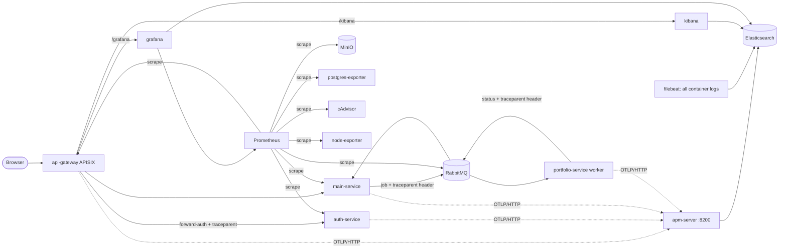

# Monitoring: metrics, logs and traces

Monitoring is **optional** (compose profile `monitoring`, decisions D23–D26). With it you get:

* **Grafana** (metrics): CPU / memory / network / disk of every container, HTTP metrics of both Go services, gateway, RabbitMQ, PostgreSQL, MinIO and the host.
* **Kibana** (logs + traces): every container's logs, and end-to-end request traces
  (gateway → auth-service → main-service → RabbitMQ → portfolio worker → status back to main-service) in Kibana **APM**.

> The infrastructure part (containers, Makefile switch, gateway routes, dashboards) is described in `plan/contracts/monitoring-t10.md`.
> The service-side instrumentation (this document's "Tracing in the code" section) lives in `auth-service`, `main-service` and `portfolio-service/worker.py`.
> Names of containers, `.env` keys and files below follow that contract; if one differs in your checkout, `make config` and `compose.yaml` win.

## Architecture



Everything in the diagram except the first four boxes runs only when monitoring is on. Exporters, Prometheus, Elasticsearch and APM Server are on the internal
docker network only (no published port in production; in dev only Prometheus `:9090`).

## Turning it on and off

| Action | How |
|---|---|
| on, permanently | `MONITORING_ENABLED=true` in `.env`, then `make dev` / `make prod` |
| on, one time | `make dev MON=1` (or `make prod MON=1`) |
| off | `MONITORING_ENABLED=false` (default) and restart: `make down` always also stops monitoring containers |

When off: no monitoring container runs, the services run with `OTEL_ENABLED=false` (a no-op tracer is installed, **no connection to the trace endpoint is ever attempted**,
no warning/error log) and the gateway answers `/grafana*` and `/kibana*` with the normal 404 JSON.

`make mon-urls` prints the two URLs and the login **user names** (never passwords).

## URLs and logins

| Tool | URL | Login (`.env` keys; read the values from your `.env`) |
|---|---|---|
| Grafana | `<PUBLIC_BASE_URL>/grafana/` | `GRAFANA_ADMIN_USER` / `GRAFANA_ADMIN_PASSWORD` |
| Kibana | `<PUBLIC_BASE_URL>/kibana/` | user `elastic`, password `ELASTIC_PASSWORD` |
| Prometheus (dev only) | `http://localhost:${PROMETHEUS_HOST_PORT}` | none (debug only; not published in prod) |

Other `.env` keys used: `KIBANA_SYSTEM_PASSWORD`, `ES_INGEST_PASSWORD` (filebeat / APM Server writer), `ES_READER_PASSWORD` (Grafana's read-only user),
`KIBANA_ENCRYPTION_KEY` (≥ 32 characters), `APM_SECRET_TOKEN` (the services send it as `Authorization: Bearer …`), `POSTGRES_MONITOR_PASSWORD`,
`ES_HEAP_MB`, `PROMETHEUS_RETENTION`, `OTEL_SAMPLE_RATIO`. The ABET login is **not** used for these tools: the gateway removes the `abet_session` / `abet_oauth` cookies and any `X-User-*`
header before proxying to them.

## What each Grafana dashboard shows (folder "ABET")

| Dashboard | Shows |
|---|---|
| Containers | CPU %, memory working set, network and disk I/O per compose service (variable `service`), last seen |
| Services (HTTP) | auth-service / main-service: requests per second by status class, 5xx %, p50/p95/p99 latency per route, in-flight, goroutines, heap; build queue size, consumers, timed-out submissions |
| Gateway | APISIX requests per route and status, latency (request / upstream / gateway), bandwidth, connections |
| RabbitMQ | per queue ready / unacked messages, consumers, publish / deliver / ack rates, connections, memory |
| Postgres | up, connections, transactions, database size, cache hit ratio, deadlocks, locks |
| MinIO | bucket size and objects, S3 requests and errors, traffic, free drive space |
| Host | CPU, memory, disk, network, load of the Docker host/VM |

Every dashboard has an `env` variable (dev / prod).

Notes from the acceptance run: the Containers dashboard needs cAdvisor ≥ v0.55.1 (older tags show only the host root cgroup on Docker Desktop); the "Memory limit" panels stay on
"No data" unless a compose service sets a memory limit; one-shot init containers (`minio-init`, `postgres-mon-init`, `kibana-init`) live only seconds and usually do not appear;
the 3xx / 4xx / 5xx series and the "5xx %" panels only appear after such a response was served (a healthy stack shows no 5xx); MinIO bucket metrics appear about a minute after data was written.

## Finding the trace of one submission (Kibana APM)

1. Kibana → **Observability → APM → Services**. Services shown: `api-gateway`, `auth-service`, `main-service`, `portfolio-service` (a service appears a minute or two after its first trace).
2. Open **api-gateway → Transactions**, pick `POST /auth/api/*` (or **main-service → Transactions** → `POST /api/v1/offerings/:id/submissions`), set the time range and click a sample. The waterfall shows the whole flow (one trace id across all four services):
   gateway → forward-auth (`/internal/v1/auth/verify` in auth-service) → main-service request → DB queries (`otelpgx`) → MinIO requests → `course_build_queue publish` →
   worker `course_build_queue process` (children `minio download`, `portfolio build`, `minio upload`) → main-service `course_status_queue process`.
3. To search by submission: the `job_id` equals the submission id. In the APM **Transactions → trace sample** search bar use `labels.abet_job_id : "<submission-id>"`
   (the span attribute is `abet.job_id`; Elastic maps dots to underscores in labels).
4. Spans of a failed build carry the exception and status error. The worker's `portfolio build` span covers the LaTeX run; a long bar there means a slow build.

Probes (`/healthz`, `/readyz`), `/metrics` and swagger are never traced. Database spans use the SQL text without parameter values.

## Log ↔ trace correlation

* Go services log JSON with `trace_id` and `span_id` for every record written with the request / job context (request log, error mapping, upload, status consumer, reconciler paths).
  Filebeat maps them to `trace.id` / `span.id`.
* The worker appends ` trace_id=<32 hex>` to its log lines while a job span is active; Filebeat extracts it to `trace.id`.
* Kibana's saved search **ABET errors** (`log.level: error`) is empty on a healthy stack; only JSON (Go) log lines carry `log.level`, plain lines (nginx, Grafana, worker) do not.
* In Kibana **Discover** (data view `ABET logs`) search `trace.id : "<id>"` to see all log lines of one trace across all services. In APM the trace sample's **Logs** tab does the same.
* The trace id is also printed in the `request` log line of main-service, so from a log line you can jump to the trace.

## Retention (forever) and manual cleanup

Nothing is deleted automatically from Elasticsearch (D26). Prometheus keeps `PROMETHEUS_RETENTION` (default 15d).
Delete old logs / traces by hand when disk gets tight:

```sh
make mon-prune days=90            # asks for confirmation, then deletes logs/traces older than 90 days (ENV=prod for the prod stack)
```

It never runs by itself.

### Disk watermarks

Elasticsearch protects itself when the disk fills: at 85 % used no new shards are allocated to the node (low watermark), at 90 % it tries to move shards away (high),
and at 95 % (flood stage) all indices on the node become **read-only** (`index.blocks.read_only_allow_delete`): logs and traces are then rejected. After freeing space
(`make mon-prune`) the block is removed automatically by Elasticsearch 8.x once usage drops below the high watermark. Watch the Host dashboard "disk" panel and prune before 85 %.

## RAM and disk needs

Rough figures: Elasticsearch heap `ES_HEAP_MB` (default 1024) plus about the same again for the OS cache; Kibana ≈ 0.7–1 GB; Prometheus, Grafana, cAdvisor, exporters, Filebeat and APM Server
together ≈ 1 GB. Plan **≈ 4 GB of additional RAM** for the monitoring profile and several GB of disk per month of logs/traces (depends on traffic; with `OTEL_SAMPLE_RATIO=1.0`
every request is traced; lower it, e.g. `0.1`, on a busy server). On Docker Desktop raise the VM memory accordingly.

## Tracing in the code (for developers)

* `internal/adapter/outbound/telemetry` (both Go services): `LoadConfig` reads `OTEL_ENABLED`, `OTEL_EXPORTER_OTLP_ENDPOINT`, `APM_SECRET_TOKEN`, `OTEL_SERVICE_NAME`,
  `OTEL_RESOURCE_ATTRIBUTES`, `OTEL_SAMPLE_RATIO`; `Setup` installs the W3C trace-context + baggage propagators and, only when enabled, an OTLP/HTTP exporter
  (`<endpoint>/v1/traces`, header `Authorization: Bearer <APM_SECRET_TOKEN>`, parent-based sampler with trace-id ratio). `TraceHandler` wraps the slog JSON handler and adds
  `trace_id` / `span_id`. Spans are flushed on shutdown.
* Spans: `otelgin` (name = method + route template), `otelhttp` for auth → main-service and auth → Google (discovery, token, JWKS), `otelpgx` on the pgx pool, `otelhttp`
  transport for the MinIO client, AMQP publish / consume in main-service with W3C headers (`traceparent`, `tracestate`) in the message headers.
* `portfolio-service/worker.py`: tracing only (D24). Setup runs only if `OTEL_ENABLED=true`; spans `course_build_queue process` (consumer, parent = main-service publish span),
  `minio download`, `portfolio build`, `minio upload`; the status message it publishes carries the trace context. Telemetry errors are swallowed: a build never fails because of tracing.
* Versions (Go): `go.opentelemetry.io/otel` v1.47.0 (+ `sdk`, `trace`, `otlptracehttp`), `otelgin` and `otelhttp` v0.72.0, `github.com/exaring/otelpgx` v0.13.0.
  Python: `opentelemetry-api`, `-sdk`, `-exporter-otlp-proto-http` all `1.45.1`.

## Implementation notes (as built)

* APM Server image: `docker.elastic.co/apm/apm-server:8.19.23`. It accepts **OTLP over HTTP with protobuf only** (JSON → 400); never set `OTEL_EXPORTER_OTLP_PROTOCOL=http/json`.
* The gateway's `opentelemetry` plugin takes collector/resource from APISIX **plugin_metadata**, and is added to the plugin list in `config.yaml` only when monitoring is on (`api-gateway/monitoring/`).
* Kibana's `/kibana/api/status` answers 200 without login (minimal status only); every real API (`/kibana/api/data_views`, …) answers 401 without or with a wrong password.
* Elastic images are 8.19.23, cAdvisor v0.55.1, Prometheus v3.13.4, Grafana 12.4.12 (see `compose.yaml`).

## Troubleshooting

| Symptom | Check |
|---|---|
| No traces in Kibana | `OTEL_ENABLED` is `true` in the service container (`docker compose exec main-service env \| grep OTEL`); `apm-server` is healthy; `APM_SECRET_TOKEN` is the same in services and APM Server (a wrong token answers 401 and the services log nothing loud — look at the apm-server log); sample ratio not `0` |
| Trace stops at the gateway | the gateway's `opentelemetry` plugin only runs with monitoring on; forward-auth must pass `traceparent` to auth-service |
| Worker spans missing | worker image rebuilt after `requirements.txt` changed? Look for `Tracing enabled` / `Tracing disabled, setup failed` in the worker log |
| Worker span not linked to main-service | the message has no `traceparent` header (job published while tracing was off) — a new root trace is created |
| Kibana 404 / redirect loop | `PUBLIC_BASE_URL` must equal the URL you use; Kibana runs with base path `/kibana` |
| Logs missing | filebeat only reads containers of the current compose project; check its log and the `ES_INGEST_PASSWORD` |
| Everything read-only / rejected | Elasticsearch flood-stage watermark: free disk (`make mon-prune`) |
| Elasticsearch restarts (exit 137) | not enough RAM: lower `ES_HEAP_MB` or give Docker more memory |
