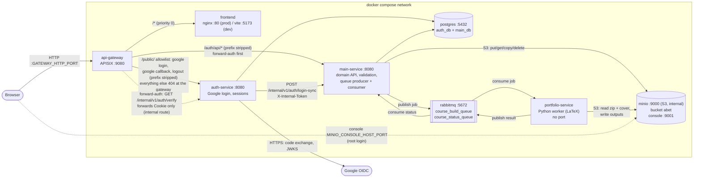
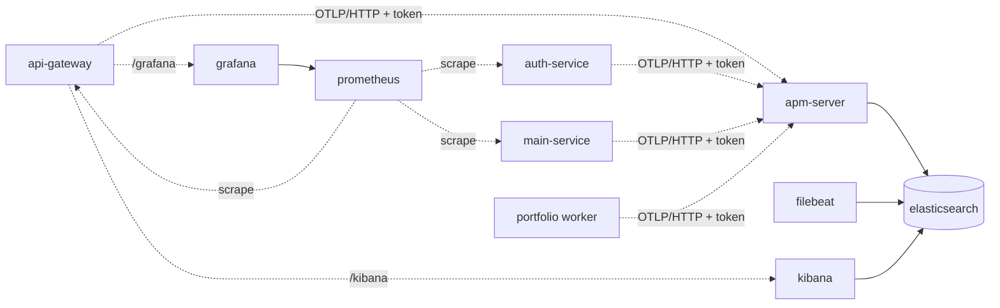
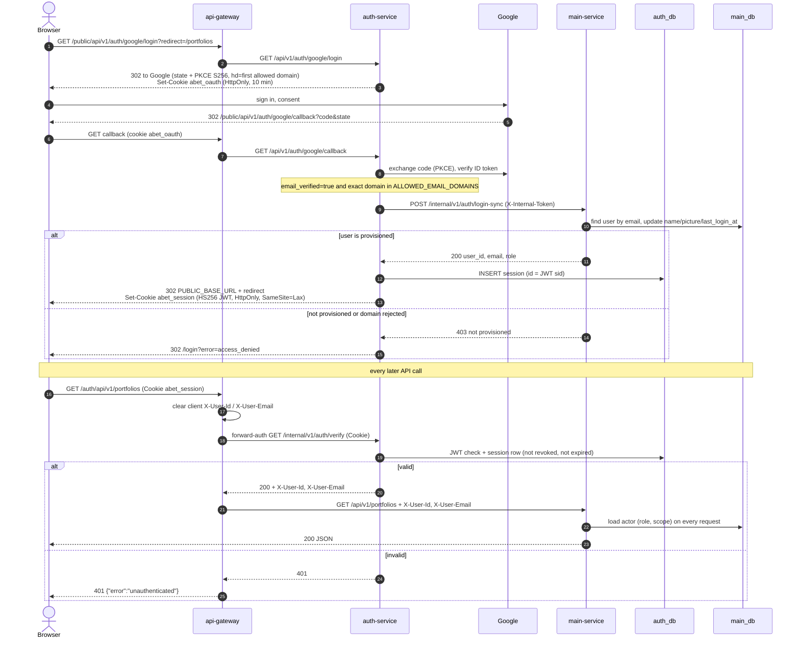
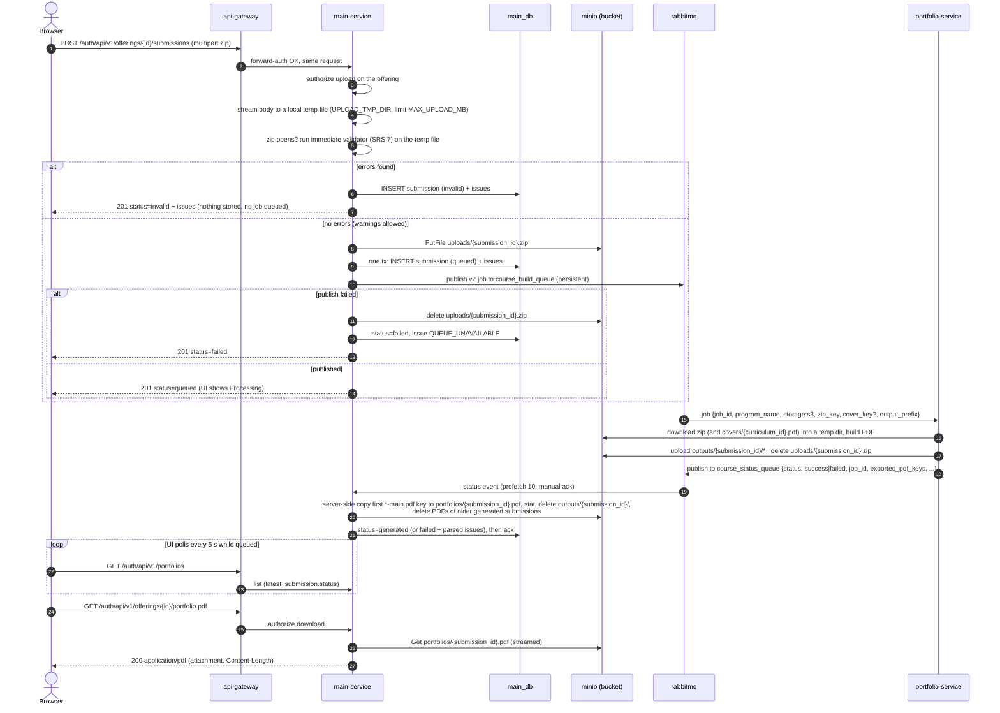
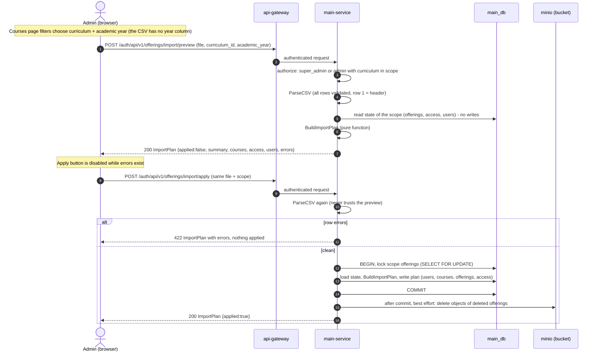

# Service diagrams

Back to the [documentation index](../../README.md).

## (a) Containers and routes

The browser only ever talks to the gateway. In production **only the gateway port is published** (`GATEWAY_HTTP_PORT`, container port 9080);
the MinIO console (`MINIO_CONSOLE_HOST_PORT`, container 9001) is published too (dev and prod; the S3 API on 9000 never in prod); in dev Postgres (`POSTGRES_HOST_PORT`) and the RabbitMQ management UI (`RABBITMQ_MGMT_HOST_PORT`) are published as well.

**Optional monitoring profile** (see [monitoring.md](../../monitoring.md)): `/grafana/*` and `/kibana/*` are extra gateway routes (cookies `abet_session` / `abet_oauth` and `X-User-*` removed); the services export OpenTelemetry traces to `apm-server:8200`; Prometheus scrapes the services' `/metrics`, the gateway, RabbitMQ, MinIO, Postgres exporter, cAdvisor and node-exporter; Filebeat ships all container logs to Elasticsearch.

| Browser path | Goes to | Auth |
|---|---|---|
| `/public/api/v1/auth/google/login`, `/public/api/v1/auth/google/callback`, `/public/api/v1/auth/logout` | auth-service (`/public` removed) | none |
| any other `/public/*` | answered by the gateway: `404 {"error":"not found"}` | none |
| `/auth/api/*` | main-service (`/auth` removed) | forward-auth against auth-service; gateway sets `X-User-Id`, `X-User-Email` |
| everything else | frontend (SPA, static assets) | none (the SPA itself redirects to `/login`) |

Not routed from outside: auth-service `/internal/*`, `/healthz`, `/readyz`, `/metrics` and main-service `/internal/*`, `/healthz`, `/readyz`, `/metrics`, swagger (`/auth/...` paths other than `/auth/api/*` answer `404` JSON). The portfolio worker runs as `PORTFOLIO_WORKER_REPLICAS` (default 2) containers consuming the same queue. Routes: [`api-gateway/apisix.prod.yaml`](../../../api-gateway/apisix.prod.yaml),
[`apisix.dev.yaml`](../../../api-gateway/apisix.dev.yaml).

Object layout in the MinIO bucket (created by the one-shot `minio-init`, which also creates the bucket-limited service account used by main-service and the worker): `uploads/`, `outputs/`, `portfolios/`, `covers/` — see [operations.md](../../operations.md#storage-layout-and-cleanup). There is no shared volume between main-service and the worker.

## (b) Google login and forward-auth on every request

Logout: `POST /public/api/v1/auth/logout` marks the session row revoked and clears the cookie, so a copied cookie stops working immediately.

## (c) Portfolio upload, validation, queue, worker, status, download

Bulk download: `POST /auth/api/v1/portfolios/download` streams one zip with every PDF the caller may download; missing or forbidden ones are listed in `MISSING.txt`.
Message formats: [operations.md](../../operations.md#queues-and-message-formats). Validation rules: [business-rules.md](../../business-rules.md#upload-validation).

## (d) Mapping CSV import: preview, then apply

The file itself is never stored (D3). Rules (create / update / keep / delete / keep_has_uploads, access mirror, new users): [business-rules.md](../../business-rules.md#mapping-csv-import).
